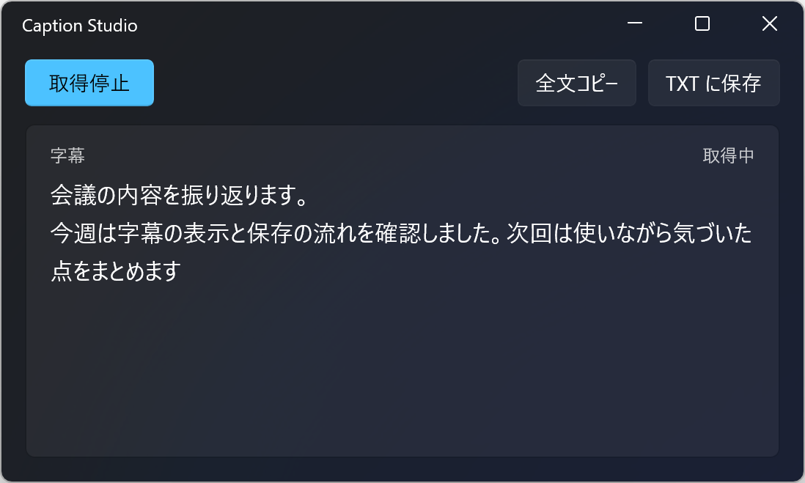

# Caption Studio


Windows 11 のライブ キャプションをリアルタイムで表示し、字幕を UTF-8 の TXT ファイルに保存するアプリです。



## ダウンロード

Windows 11 x64 向けの `CaptionStudio.exe` をダウンロードし、ファイル名はそのままでダブルクリックしてください。.NET と Windows App SDK のランタイムは EXE に含まれています。 [最新版のリリース](https://github.com/TkymHrt/caption-studio/releases/latest)

## 使い方

1. 「取得開始」を押すと、Caption Studio がライブ キャプションに接続します。ウィンドウが閉じていれば自動で開きます。
2. 日本語で使うには、ライブ キャプションの設定で日本語を選びます。言語ファイルのダウンロードを求められたら、画面の案内に従ってください。 [ライブ キャプションの設定手順](https://support.microsoft.com/ja-jp/accessibility/windows/use-live-captions-to-better-understand-audio)
3. 「取得停止」で字幕の取得を止め、同じボタンで再開できます。再開時はライブ キャプションに残っている字幕から読み取ります。
4. 「TXT に保存」で保存先を選びます。「全文コピー」では取得した字幕をクリップボードにコピーできます。未保存の字幕がある状態で閉じると、保存の確認が表示されます。

過去の字幕を読んでいる間も取得は続きます。「最新へ」を押すと末尾に戻り、新しい字幕に合わせてスクロールします。

「接続待ち」が続くときは、`Win` + `Ctrl` + `L` でライブ キャプションを開いてください。

## 開発

ソースから起動するには、Windows の開発者モードを有効にし、mise と WinApp CLI 0.7.1 以降を用意してください。WinApp CLI は `winget install --id Microsoft.WinAppCli --exact` でインストールできます。 [mise のインストール](https://mise.jdx.dev/)

リポジトリのルートで次を実行してください。

```powershell
mise install
mise exec -- winapp run CaptionStudio/CaptionStudio.csproj --arch x64
```

実装方針、検証手順、配布用 EXE の作成手順は [AGENTS.md](AGENTS.md) を参照してください。
